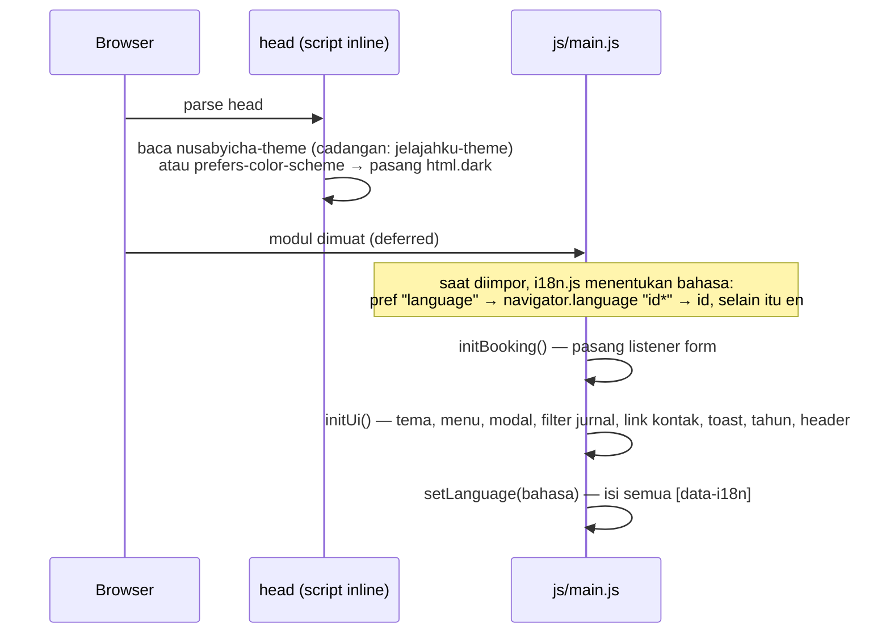
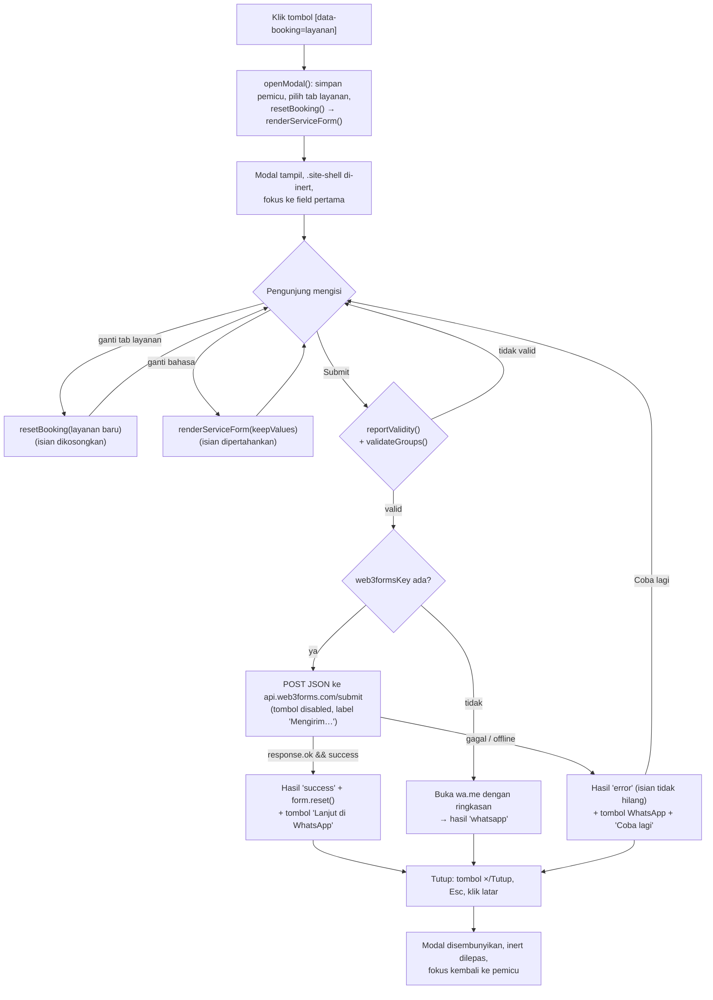

# Logic flow — NusaByIcha

Alur utama situs: saat halaman dimuat, pengaturan bahasa dan tema, interaksi halaman, lalu formulir
layanan. Data form dijelaskan di [schema.md](schema.md), konfigurasi di [tech-stack.md](tech-stack.md).

## 1. Saat halaman dimuat

- **Tema.** Script inline memasang kelas `dark` sebelum halaman tampil agar tidak berkedip. Setelah itu
  `initTheme()` (`ui.js`) menyamakan ikon dan `meta[theme-color]`:
  - Klik tombol tema menyimpan pilihan `light`/`dark`.
  - Selama pengunjung belum pernah memilih, tema ikut berubah saat setelan sistem berubah.
- **Bahasa.** `setLanguage()` (`i18n.js`) menyimpan pilihan, mengubah `<html lang>`, lalu mengisi teks:
  - Kunci `*Html` dipasang dengan `innerHTML`, sisanya dengan `textContent`.
  - `aria-label` diambil dari `data-i18n-label`.
  - Setelah itu semua listener `onLanguageChange` dipanggil.
- **Penyimpanan.** Semua akses `localStorage` dibungkus `try/catch` (`storage.js`). Kunci lama berprefix
  `jelajahku-` dipindahkan ke `nusabyicha-` saat pertama kali dibaca.
- **`privacy.html`** hanya menjalankan script tema inline. Halaman ini tidak memuat modul JS, jadi tidak
  ada tombol bahasa atau tema di sana. Teks ID dan EN keduanya ditulis langsung di halaman.

## 2. Interaksi halaman (`ui.js`)

- **Menu mobile.** `aria-expanded` di-toggle. Menu tertutup saat link diklik atau saat menekan Esc, lalu
  fokus kembali ke tombol menu.
- **Filter jurnal.** Tombol tahun dibuat otomatis dari `data-year` kartu, diurutkan dari yang terbaru.
  Satu filter cocok kalau nilainya `all`, sama dengan `data-location`, atau sama dengan `data-year`. Kartu
  yang tidak cocok diberi kelas `filter-hidden`. Tombol aktif diberi `aria-pressed`.
- **Link kontak.** Link `[data-whatsapp-link]` dan `[data-social]` diisi dari `config.js`. Ikon yang
  nilainya kosong dihapus dari halaman.
- **Toast.** Tombol `[data-toast]` (misalnya "Lihat semua cerita") menampilkan isi atributnya selama 3 detik.
- **Header** mendapat kelas `scrolled` setelah halaman digulir lebih dari 30 px. Tahun di
  `[data-year-now]` terisi otomatis.

## 3. Modal formulir layanan

Rinciannya:

- **Render form** (`booking.js`):
  - `fieldMarkup()` membangun HTML dari `formSchemas[layanan]`. Semua teks dan nilai di-escape dengan
    `escapeHtml()`.
  - Tanggal tidak bisa diisi dengan hari yang sudah lewat. `endDate` minimal sama dengan `startDate`.
  - Field `conditional: 'multi'` hanya tampil (dan aktif) kalau `package = multi`.
  - Catatan konsultasi di form `plan` muncul kalau `service = consultation`.
- **Validasi.** Selain validasi bawaan browser, `validateGroups()` mewajibkan minimal satu centang di
  setiap grup `[data-required-group]`. Pesan galatnya muncul di grup itu, lalu halaman menggulir dan
  memfokuskan grup tersebut.
- **Isi kiriman.** `collectAnswers()` menyusun pasangan "Label: nilai" sesuai urutan schema, dalam bahasa
  yang sedang aktif. Label opsi diterjemahkan dan nilai kosong dilewati. Bentuk payload-nya ada di
  [schema.md](schema.md).
- **Ringkasan WhatsApp.** Diawali sapaan dan judul layanan, lalu satu baris `• Label: nilai` per jawaban.
  Panjangnya dipotong di 1.500 karakter.
- **Anti-spam.** Checkbox `botcheck` tersembunyi. Nilainya ikut dikirim, dan Web3Forms membuang kiriman
  yang mencentangnya.
- **Mencegah kirim dua kali.** Selama permintaan berjalan, tanda `sending` aktif dan tombol submit
  dinonaktifkan.
- **Fokus.** Saat modal terbuka, Tab dan Shift+Tab berputar di dalam dialog. Panel hasil
  (`aria-live="polite"`) mendapat fokus saat ditampilkan.

## 4. Deploy

Alurnya: push ke `main`, GitHub Actions menjalankan `check.sh` dan Prettier, dan secara terpisah Vercel
men-deploy `public/` ke production (https://web-icha.vercel.app). Dengan setelan bawaan, Vercel tidak
menunggu hasil CI, jadi jalankan `./scripts/check.sh` sebelum push.
